# Tomáš Vlasák

Student developer from the Czech Republic. I build full-stack web apps with TypeScript, React and Next.js, and I built the website for my local parish in Čelákovice.

  
  
  <!-- To add more links, remove the comment markers around a line and fill in your details:
  
  
  
  -->

### Tech stack

  
  
  
  

  
  
  
  
  

  
  
  
  

### GitHub stats

  <picture>
    <source media="(prefers-color-scheme: dark)" srcset="https://raw.githubusercontent.com/tomasvlasakdev/tomasvlasakdev/main/profile/stats-dark.svg">
    
  </picture>
  <picture>
    <source media="(prefers-color-scheme: dark)" srcset="https://raw.githubusercontent.com/tomasvlasakdev/tomasvlasakdev/main/profile/top-langs-dark.svg">
    
  </picture>

